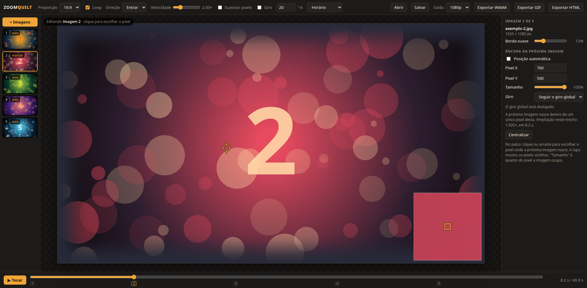

# Zoom Quilt Editor

Editor visual para criar animações de **zoom infinito** (estilo *zoomquilt* / efeito Droste): cada imagem fica escondida dentro de um único pixel da imagem anterior e vai se revelando conforme a câmera avança. O resultado pode ser assistido no próprio editor ou exportado como vídeo WebM, GIF ou uma página HTML autossuficiente.



Tudo vive em **um único `index.html`**: sem build, sem `npm install`, sem dependências externas e sem chamadas de rede.

---

## Sumário

- [Recursos](#recursos)
- [Como rodar](#como-rodar)
- [Guia rápido](#guia-rápido)
- [Interface](#interface)
- [Conceitos](#conceitos)
  - [Âncora e "pixel"](#âncora-e-pixel)
  - [Preenchimento](#preenchimento)
  - [Borda suave](#borda-suave)
  - [Giro](#giro)
  - [Profundidade `z` e tempo](#profundidade-z-e-tempo)
- [Exportações](#exportações)
- [Projetos (salvar/abrir)](#projetos-salvarabrir)
- [Atalhos](#atalhos)
- [Como funciona por dentro](#como-funciona-por-dentro)
- [Limitações](#limitações)
- [Compatibilidade](#compatibilidade)
- [Estrutura do repositório](#estrutura-do-repositório)
- [Contribuição](#contribuição)
- [Licença](#licença)

---

## Recursos

- **Cadeia de imagens** em tira lateral, com reordenação por arrastar e soltar e remoção individual.
- **Âncora automática**: escolhe dentro da imagem-mãe o pixel cuja cor mais combina com a borda da imagem-filha (com refinamento em resolução cheia).
- **Ajuste manual de pixel**: clique ou arraste direto no palco; lupa com os pixels vizinhos e marcador em cruz.
- **Borda suave** (feather) por imagem, para a transição entre camadas não ficar com recorte duro.
- **Giro** por trecho: seguir o giro global (graus/segundo), não girar, ou um ângulo personalizado.
- **Controles globais** de proporção (16:9, 4:3, 1:1, 3:4, 9:16), loop, direção (entrar/sair), velocidade e suavização de pixels.
- **Prévia em tempo real** com linha do tempo, marcadores por imagem e relógio de duração.
- **Exportação** para WebM, GIF e HTML standalone (com as imagens embutidas e o motor copiado para dentro do arquivo).
- **Salvamento automático** do projeto no navegador (IndexedDB), além de salvar/abrir `.json`.
- **Imagens de exemplo** geradas proceduralmente para testar sem precisar de arquivos.
- **Interface responsiva** (painel vai para baixo em telas estreitas) e navegação por teclado.

---

## Como rodar

Não há instalação. Basta servir a pasta com qualquer servidor estático:

```bash
python3 -m http.server 8765 --bind 127.0.0.1
```

Depois abra <http://127.0.0.1:8765/>.

O repositório já traz essa configuração em `.claude/launch.json` (nome `zoomquilt`). Também é possível abrir o `index.html` diretamente no navegador, mas servir por HTTP garante que o IndexedDB e o carregamento de imagens se comportem igual em todos os navegadores.

---

## Guia rápido

1. Clique em **+ Imagens** (ou arraste arquivos para a janela) e escolha duas ou mais imagens.
2. Selecione uma imagem na tira lateral.
3. No palco, clique no ponto onde a **próxima** imagem deve nascer. A lupa mostra os pixels em volta.
4. Ajuste **Borda suave** e **Tamanho** até a transição ficar natural.
5. Use **▶ Tocar** para ver o zoom contínuo; arraste a linha do tempo para inspecionar qualquer profundidade.
6. Exporte em **WebM** (qualidade), **GIF** (teste rápido) ou **HTML** (player independente).

Quem só quer ver funcionando pode usar **Usar imagens de exemplo** na tela inicial.

---

## Interface

| Área | O que faz |
|---|---|
| **Barra superior** | Proporção, loop, direção, velocidade, suavização, giro global (ligado/desligado, °/s, sentido), abrir/salvar projeto e botões de exportação. |
| **Tira esquerda** | Lista numerada das imagens. Clique para editar, `×` para remover, arraste para reordenar. O selo `auto`/`manual` indica a origem da âncora. |
| **Palco central** | Renderização ao vivo. Em modo edição mostra o marcador da âncora e a lupa; em modo prévia, clique pausa/retoma. |
| **Painel direito** | Propriedades da imagem selecionada: nome, dimensões, borda suave, posição da âncora (automática ou pixel X/Y), tamanho, modo de giro e diagnósticos (ampliação do trecho, duração, ângulo aplicado). |
| **Rodapé** | Botão tocar/pausar, linha do tempo com marcadores clicáveis e tempo decorrido/total. |

---

## Conceitos

### Âncora e "pixel"

A imagem *i* é a **mãe**; a imagem *i+1* é a **filha** e mora dentro de um único pixel da mãe. A posição é sempre encaixada no **centro de um pixel** (`tx`, `ty`), e a escala da filha é derivada desse pixel: ela ocupa no máximo um pixel da mãe e é invisível até o zoom chegar ali.

Como a posição é quantizada em pixels reais da mãe, mexer no **Tamanho** ou trocar a proporção do quadro não quebra o encaixe — o editor recalcula a escala e o centro do pixel.

**Posição automática** analisa a miniatura 64 px da filha, calcula a cor média de sua borda e procura, na mãe, o pixel de cor mais próxima. Há uma penalidade para afastar a escolha do centro da mãe (evita âncoras nas extremidades) e uma segunda passada em resolução cheia que também considera a opacidade. Resultado: a emenda fica escondida numa região de cor parecida.

### Preenchimento

**Tamanho** (10–100%) define quanto do pixel a filha ocupa. Em 100% ela preenche o pixel inteiro; valores menores criam uma margem de respiro ao redor da "porta" de entrada. Como tudo é medido em pixels da mãe, o valor é estável independentemente da resolução.

### Borda suave

Aplicada por imagem como uma máscara (0–50% do menor lado), apagando gradualmente as quatro bordas. Serve para disfarçar o limite entre a imagem atual e as camadas ancestrais que aparecem atrás dela — especialmente quando as imagens têm proporções diferentes. A primeira imagem com o loop desligado não recebe borda, porque não está dentro de nada.

### Giro

- **Seguir o giro global** — usa a velocidade global em °/s multiplicada pela duração do trecho (que depende do quanto a imagem é ampliada). Trechos mais longos giram mais.
- **Não girar** — mantém o trecho alinhado.
- **Personalizado** — ângulo fixo em graus e sentido, convertidos para a taxa equivalente do trecho.

No motor, o giro é um número complexo na âncora (`a = s · e^{ir}`), então rotação e escala acontecem juntas, sem descontinuidade. Ao tocar no sentido "sair", o sentido do giro se inverte automaticamente.

### Profundidade `z` e tempo

`z` é contínuo: a parte inteira indica qual imagem está na frente e a fracionária, o quanto do trecho já foi percorrido. O avanço é feito em **espaço logarítmico**, para a sensação de velocidade ser constante mesmo quando cada trecho tem uma ampliação diferente. Com velocidade `1×`, a imagem dobra de tamanho a cada **1,5 s**; a duração de cada trecho é `log(1/s) / taxa`.

Com loop ligado, `z` vai de `0` a `N`; desligado, de `0` a `N-1` (a última imagem não tem filha, então o zoom termina ali).

---

## Exportações

| Formato | Detalhes |
|---|---|
| **WebM** | `MediaRecorder` em 60 fps a 16 Mbps, gravando um canvas offscreen na resolução escolhida (720p/1080p/1440p conforme a proporção). Usa VP9 → VP8 → MP4 conforme o suporte do navegador. A gravação é **em tempo real**: mantenha a aba visível durante o processo. |
| **GIF** | 15 fps, 360 px no lado maior, paleta fixa de 255 cores (6×7×6), pontilhado ordenado Bayer 4×4 e compactação LZW própria. Bom para testes; para resultado final, prefira WebM. |
| **HTML** | Gera uma página única com as imagens embutidas como JPEG (máx. 2048 px), o motor serializado via `ZQEngine.toString()` e um player mínimo: clique/`Espaço` pausa, roda do mouse avança ou retrocede, redimensiona com a janela. Não depende de nada externo. |

Todas as exportações mostram um modal com progresso e botão **Cancelar**, e exigem que todas as imagens já tenham terminado de carregar.

---

## Projetos (salvar/abrir)

- **Salvar** baixa um `zoomquilt.json` com `app`, `version`, `settings` e, por imagem, `name`, `feather`, `fill`, `rmode`, `rdeg`, `rdir`, `auto`, `x`, `y`, `s`, `r` e os bytes em data URL.
- **Abrir** valida a assinatura `zoomquilt-editor` antes de aplicar.
- **Autosave**: após 600 ms de inatividade, o estado (configurações + blobs) é gravado no IndexedDB (`zoomquilt-editor` → store `kv` → chave `project`) e restaurado na próxima abertura, sem passar pelo disco.

---

## Atalhos

| Tecla | Ação |
|---|---|
| `Espaço` | Tocar / pausar |
| `←` / `↑` | Imagem anterior |
| `→` / `↓` | Próxima imagem |
| Clique no palco | Define a âncora (em edição) ou pausa (em prévia) |
| Arrastar no palco | Move a âncora continuamente |

No HTML exportado: clique ou `Espaço` pausa; roda do mouse percorre o zoom.

---

## Como funciona por dentro

- **Coordenadas do quadro**: origem no centro, altura `1`, largura `A` (a proporção). Assim, todo o cálculo é independente da resolução de saída.
- **Transformação em números complexos**: a posição da filha é `p = c + a·q`, com `a = s·e^{ir}`. Ao renderizar numa profundidade fracionária `f`, o motor interpola em torno do ponto fixo `F = c/(1-a)`, obtendo um zoom que gira e amplia sem solavanco.
- **Mipmaps**: cada imagem é reduzida a no máximo 2048 px e ganha uma cadeia de níveis. Para cada camada, o motor escolhe o nível mais próximo do tamanho de tela e desenha apenas o recorte visível — o que preserva precisão mesmo em ampliações de milhares de vezes.
- **Camadas visíveis**: desenham até duas imagens ancestrais atrás da atual (aparecem através da borda suave e nas faixas de proporção diferente) e descem pelas filhas até a próxima ficar menor que um pixel.
- **Suavização de pixels**: reduzir sempre suaviza (evita cintilação); ampliar usa vizinho mais próximo, a menos que "Suavizar pixels" esteja ligado.
- **Renderização sob demanda**: um único `requestAnimationFrame` redesenha apenas quando algo muda (`dirty`), com `ResizeObserver` ajustando o canvas ao espaço disponível e ao `devicePixelRatio`.

O motor (`ZQEngine`) é intencionalmente autossuficiente e sem dependências de estado global, porque seu código-fonte é copiado literalmente para dentro do player HTML exportado.

---

## Limitações

- Imagens são reduzidas para no máximo **2048 px** no maior lado ao montar os quadros.
- GIF é limitado a 360 px e 15 fps; vídeo é gravado em tempo real (aba visível, duração = duração da animação).
- O HTML exportado embute as imagens como JPEG (perda leve) e remonta a cadeia de mipmaps e a borda suave no navegador ao abrir.
- Não há desfazer/refazer, camadas extras, áudio ou curvas de velocidade.
- O projeto é salvo por navegador (IndexedDB), não em nuvem.

---

## Compatibilidade

Funciona nas versões atuais de Chrome, Edge, Firefox e Safari. Recursos exigidos: Canvas 2D, `createImageBitmap`, IndexedDB, `ResizeObserver` e `MediaRecorder` (apenas para exportar vídeo — o editor avisa quando o navegador não suporta).

---

## Estrutura do repositório

```
Zoom-Quilt-Editor/
├── index.html          # aplicação completa (HTML + CSS + JS, sem dependências)
├── README.md
├── LICENSE             # MIT
├── docs/
│   └── screenshot.png  # captura de tela usada neste README
└── .claude/
    └── launch.json     # configuração de servidor local (porta 8765)
```

O app é um arquivo único de propósito: dá para copiar o `index.html` para qualquer lugar, abrir e usar — inclusive offline. Não existe etapa de build, transpilação ou instalação de pacotes.

---

## Contribuição

Sugestões e correções são bem-vindas. Como o projeto é um arquivo só, o fluxo é simples:

1. Faça um fork e crie um branch descritivo (`feat/giro-por-trecho`, `fix/ancora-fora-do-limite`).
2. Edite `index.html` — mantenha o estilo do arquivo: sem dependências, sem framework, JavaScript moderno direto no `script`, nomes curtos e comentários em português nos trechos não óbvios.
3. Se mexer no `ZQEngine`, lembre-se de que essa função é serializada com `toString()` para dentro do HTML exportado: ela **não pode** referenciar nada de fora do próprio corpo (nem variáveis globais, nem helpers definidos depois). O player exportado precisa continuar funcionando sozinho.
4. Teste nos dois caminhos: editor e **Exportar HTML**, além de WebM/GIF se a mudança tocar em renderização.
5. Abra o pull request explicando o que mudou e como testar.

Ao reportar um problema, inclua navegador e versão, quantas imagens o projeto tem e os passos para reproduzir. Se for um bug visual, uma captura ajuda bastante.

Ideias que ainda não estão implementadas, caso queira contribuir: desfazer/refazer, curvas de velocidade (easing) por trecho, exportação de frames PNG em sequência, suporte a áudio no WebM e presets de animação.

---

## Licença

Distribuído sob a **licença MIT** — veja [LICENSE](LICENSE). Em resumo: use, modifique e redistribua livremente, inclusive comercialmente, mantendo o aviso de copyright.
